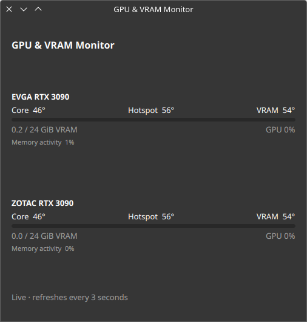

# GPU & VRAM Monitor for KDE Plasma 5

A compact panel widget showing NVIDIA GPU core and VRAM temperatures, GPU load,
and used/total VRAM. Hover for hotspot temperature and memory activity. Updates
every three seconds, supports multiple GPUs, follows Plasma theme colors, and
marks unavailable or stale readings. Clear Core/VRAM labels and compact allocation
meters make the panel easy to scan; click for a detailed per-GPU view. Originally used with two RTX 3090 cards.

## Screenshots

Live captures on Plasma 5.27 with two RTX 3090 cards. The widget detects GPU
labels automatically. Click it, or focus it and press Enter/Space, for details.


[View the full top panel](docs/screenshots/top-panel.png).



## Requirements

- Linux with **KDE Plasma 5.27**, Python 3.9+, and `kpackagetool5`.
- NVIDIA proprietary driver with `nvidia-smi` available.
- For RTX 3090 VRAM/hotspot readings: the included root-owned sensor service.
  It uses Python's standard library and read-only PCI resource mappings.

**No gputemps dependency, libpci dependency, Python package install, DKMS module,
or /dev/mem access is needed.** The NVIDIA driver and nvidia-smi remain required.
This release targets Plasma 5.27; **Plasma 6 is not supported.**

The register reader currently allows only PCI device `10de:2204` (RTX 3090),
validated on two cards. Other GPUs still show core temperature, load and VRAM
usage through nvidia-smi. Memory temperature is also used from nvidia-smi where
supported; otherwise unsupported channels show a dash. Register access may be
blocked by kernel lockdown or platform policy; the widget keeps working with
those channels unavailable.

## Install

Download and extract the source `.tar.gz` from Releases, then run:

```sh
cd plasma-gpu-vram-monitor-1.2.0
./install.sh
```

The installer backs up any existing applet/helper under
`~/.local/state/plasma-gpu-vram-monitor/backups/`, installs the Python helper in
`~/.local/bin`, and installs or upgrades the applet. Add **GPU & VRAM Monitor**
through Plasma's **Add Widgets** menu. It does not modify panel layouts, themes,
or restart your desktop. An existing applet may require your next login to pick
up changed QML. The applet ID remains `local.gpu.monitor` for existing users.

The standalone `.plasmoid` archive can also be installed with
`kpackagetool5 --type Plasma/Applet --install gpu-vram-monitor-1.2.0.plasmoid`;
the Python helper is bundled inside the widget, so no separate helper installation
is needed. The external NVIDIA driver is still required. Install the optional sensor service
from the full source bundle for RTX 3090 VRAM/hotspot temperature:

```sh
sudo ./sensors/install.sh
```

This explicit administrator step installs a root-owned reader and system service.
The service samples two fixed read-only register addresses on allowlisted,
active NVIDIA devices, then publishes a root-owned cache in `/run`. The widget
itself runs as your normal user and never invokes sudo. No GPU registers are
written, and no driver, firmware, fan, clock, or boot settings are changed.
See [reader design, provenance and limitations](docs/sensor-reader.md).

## Troubleshooting

Run these as your normal desktop user:

```sh
nvidia-smi
systemctl status gpu-vram-monitor-sensors
cat /run/gpu-vram-monitor/temperatures.json
~/.local/bin/gpu-panel-data
```

The helper returns JSON with `ok: true` when GPU usage is available. Missing
thermal channels display a dash. Temperature cache samples older than 15 seconds
or with future timestamps are rejected. PCI addresses join temperature samples
to NVIDIA data, independent of GPU enumeration order. No machine UUIDs are
stored. The only helper subprocess is nvidia-smi, with an eight-second timeout.

## Remove

```sh
kpackagetool5 --type Plasma/Applet --remove local.gpu.monitor
rm ~/.local/bin/gpu-panel-data
```

To remove this project's optional temperature service:

```sh
sudo systemctl disable --now gpu-vram-monitor-sensors
sudo rm /etc/systemd/system/gpu-vram-monitor-sensors.service
sudo rm /usr/local/libexec/gpu-vram-monitor-sensors
sudo systemctl daemon-reload
```

Remove the widget from the panel first. Keep any independent gputemps reader or
hwmon bridge if other programs use it. Backups remain available for restoration.

## Development and packages

```sh
python3 -m unittest discover -s tests -v
sh -n install.sh
python3 scripts/package.py
```

`dist/` contains a `.plasmoid`, complete source/installer `.tar.gz`, and SHA-256
checksums. GPL-3.0; see LICENSE. No upstream gputemps implementation is bundled.
Technical provenance is recorded in docs/sensor-reader.md.
