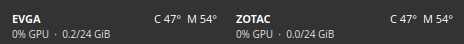
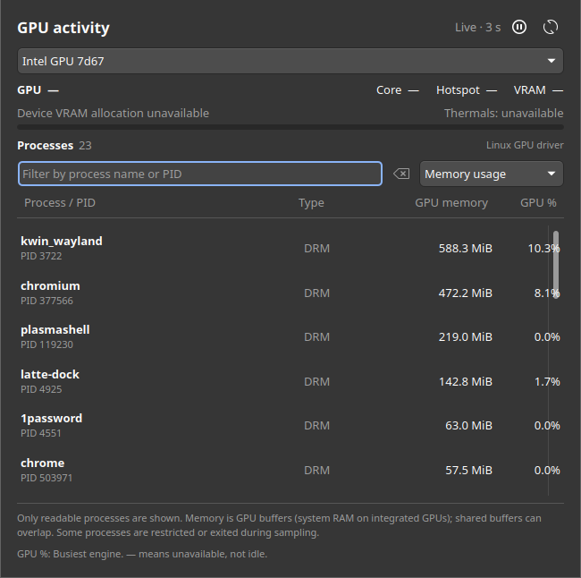

# GPU & VRAM Monitor for KDE Plasma 5

A compact panel widget showing GPU core and VRAM temperatures, GPU load,
and used/total VRAM. Hover for hotspot temperature and memory activity. Updates
every three seconds, supports multiple GPUs, follows Plasma theme colors, and
marks unavailable or stale readings. Clear Core/VRAM labels and compact allocation
meters make the panel easy to scan. Click a GPU for a searchable task view with
process names, PIDs, GPU memory allocations and activity where the driver exposes it. Originally used with two RTX 3090 cards.

## Screenshots

Live captures on Plasma 5.27 with two RTX 3090 cards. The widget detects GPU
labels automatically. Click it, or focus it and press Enter/Space, for details.



[View the full top panel](docs/screenshots/top-panel.png).

## GPU processes

Click a GPU in the panel, then choose a device in the expanded activity view.
Filter by name or PID, sort by memory/GPU usage/name, and pause or refresh the task
list. Click a row for memory/sharing details. Device summaries keep updating
while the task list is paused.

NVIDIA uses graphics + compute process telemetry; other drivers use readable
DRM client statistics. Process-only GPUs also appear in the selector. Missing
utilization shows a dash, not a guessed 0%. On integrated GPUs, process memory
can be system-memory GPU buffers rather than dedicated VRAM.



[View the empty-task state](docs/screenshots/processes-empty.png) ·
[Sources, units, permissions and limitations](docs/process-monitoring.md).

Task collection is unprivileged and only requested while the expanded view is
open. Diagnostic reports continue to exclude process data.

## Requirements

- Linux with **KDE Plasma 5.27**, Python 3.9+, and `kpackagetool5`.
- A Linux GPU driver exposing NVIDIA management telemetry or GPU-attached hwmon.
- Optional NVIDIA direct thermals: the included root-owned sensor service.

No gputemps, libpci, third-party Python packages, DKMS or /dev/mem dependency.
**Plasma 6 is not supported.** Sensor availability depends on the GPU and driver.

## Hardware support

- **Verified:** RTX 3090 direct VRAM/hotspot readings, tested on two local cards.
- **Experimental, opt-in:** RTX 3080, 3080 Ti and 3090 Ti researched PCI IDs.
  These have simulated tests, not real-card confirmation.
- **Driver-provided:** NVIDIA telemetry through nvidia-smi; AMD temperatures,
  load and VRAM allocation through amdgpu sysfs/hwmon; Intel GPU temperatures
  only when i915/xe exposes them. Legacy Radeon and Nouveau GPU temperatures
  and labeled hwmon attached to other DRM GPUs are also read when available.
- **Unknown direct-register layouts:** blocked, including 40/50-series in this release.

PCI display devices and DRM GPUs (including non-PCI devices) are discovered
without a model whitelist. Detection is not a promise of working telemetry.
Detected GPUs with no readable sensors appear in details with their status.
JSON reports per-metric capabilities and explains missing readings. Older
NVIDIA drivers that reject optional CSV fields get an XML query fallback.

**VRAM/hotspot temperature cannot be guaranteed for every GPU.** The driver or
a compatible, validated register profile must expose that reading. GTX 1080,
for example, can provide standard NVIDIA telemetry but has no direct thermal
profile here. We do not apply RTX register offsets to Pascal or unknown chips.

[Exact PCI IDs, opt-in instructions and community testing](docs/hardware-support.md).
Synthetic fixtures cover AMD/Intel parsing; they do not prove hardware support.

## Install

Download and extract the source `.tar.gz` from Releases, then run:

```sh
cd plasma-gpu-vram-monitor-1.5.0
./install.sh
```

The installer backs up any existing applet/helper under
`~/.local/state/plasma-gpu-vram-monitor/backups/`, installs the Python helper in
`~/.local/bin`, and installs or upgrades the applet. Add **GPU & VRAM Monitor**
through Plasma's **Add Widgets** menu. It does not modify panel layouts, themes,
or restart your desktop. An existing applet may require your next login to pick
up changed QML. The applet ID remains `local.gpu.monitor` for existing users.

The standalone `.plasmoid` archive can also be installed with
`kpackagetool5 --type Plasma/Applet --install gpu-vram-monitor-1.5.0.plasmoid`;
the Python helper is bundled inside the widget, so no separate helper installation
is needed. A supported GPU driver is still required. Install the optional sensor service
from the full source bundle for RTX 3090 VRAM/hotspot temperature:

```sh
sudo ./sensors/install.sh
```

This explicit administrator step installs a root-owned reader and system service.
The service samples two fixed read-only register addresses on allowlisted,
active NVIDIA devices, then publishes a root-owned cache in `/run`. The widget
itself runs as your normal user and never invokes sudo. No GPU registers are
written, and no driver, firmware, fan, clock, or boot settings are changed.
See [reader design, provenance and limitations](docs/sensor-reader.md).

## Troubleshooting

Run these as your normal desktop user:

```sh
# NVIDIA only:
nvidia-smi
systemctl status gpu-vram-monitor-sensors
cat /run/gpu-vram-monitor/temperatures.json
~/.local/bin/gpu-panel-data
```

The helper returns JSON with `ok: true` when GPUs are detected; `cards` contains
readable telemetry and `devices` also includes GPUs without readable sensors. Missing
thermal channels display a dash. Temperature cache samples older than 15 seconds
or with future timestamps are rejected. PCI addresses join temperature samples
to NVIDIA data, independent of GPU enumeration order. No machine UUIDs are
stored. The only telemetry subprocess is nvidia-smi, with an eight-second timeout;
Other driver reads use standard sysfs/hwmon files and do not need it.

To help test a card without automatic uploads:

```sh
~/.local/bin/gpu-panel-data --diagnose > gpu-report.json
```

Review the report and use our [hardware report form](https://github.com/etreby/plasma-gpu-vram-monitor/issues/new?template=hardware-test.yml).

## Remove

```sh
kpackagetool5 --type Plasma/Applet --remove local.gpu.monitor
rm ~/.local/bin/gpu-panel-data ~/.local/bin/gpu_tasks.py
```

To remove this project's optional temperature service:

```sh
sudo systemctl disable --now gpu-vram-monitor-sensors
sudo rm -f /etc/systemd/system/gpu-vram-monitor-sensors.service.d/experimental.conf
sudo rm /etc/systemd/system/gpu-vram-monitor-sensors.service
sudo rm /usr/local/libexec/gpu-vram-monitor-sensors
sudo systemctl daemon-reload
```

Remove the widget from the panel first. Keep any independent gputemps reader or
hwmon bridge if other programs use it. Backups remain available for restoration.

## Development and packages

```sh
python3 -m unittest discover -s tests -v
sh -n install.sh
python3 scripts/package.py
```

`dist/` contains a `.plasmoid`, complete source/installer `.tar.gz`, and SHA-256
checksums. GPL-3.0; see LICENSE. No upstream gputemps implementation is bundled.
Technical provenance is recorded in docs/sensor-reader.md.
